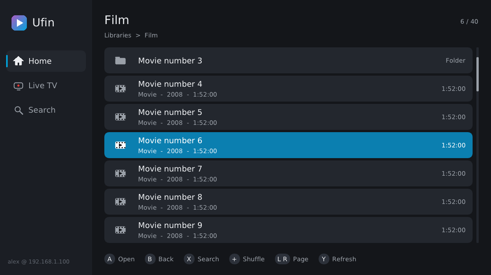
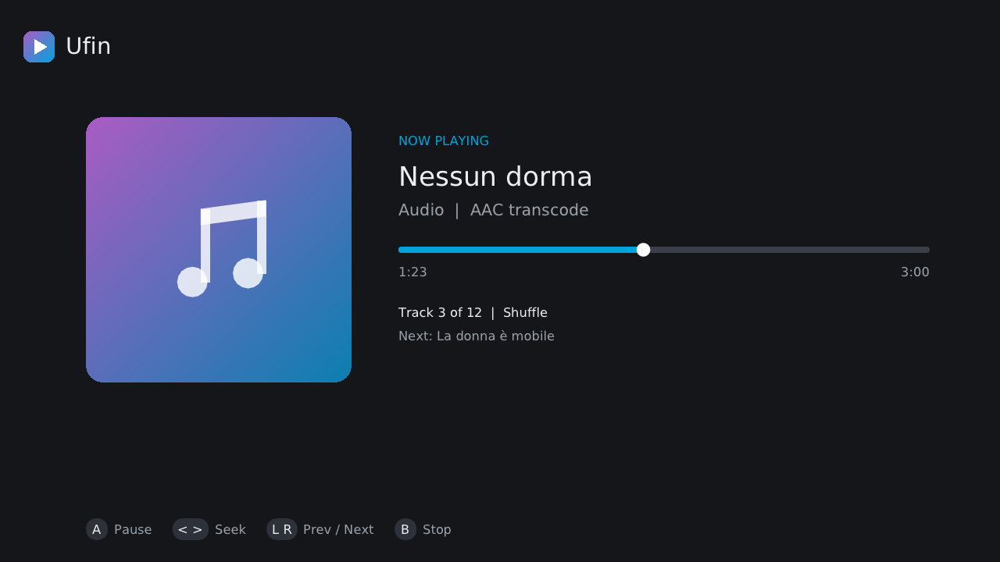
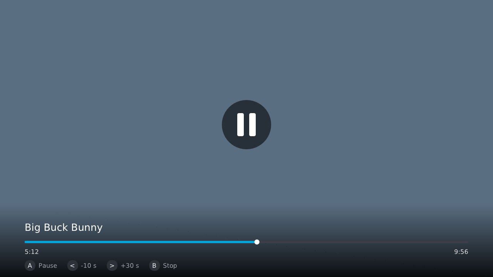
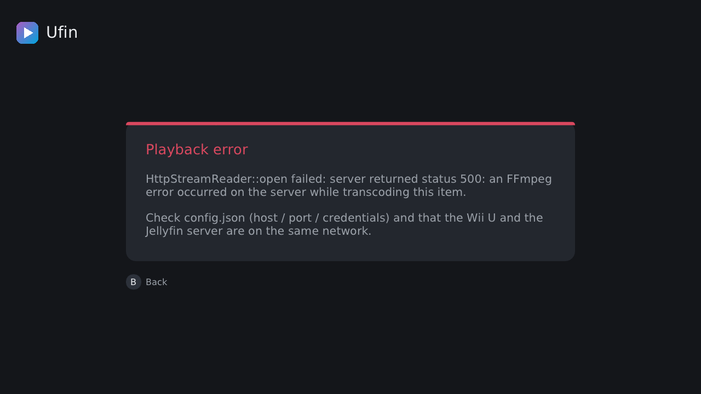

# Ufin - A Wii U Jellyfin client

WIP jellyfin client for the Nintendo Wii U

---

A native Jellyfin client for the Nintendo Wii U, because why not XD.

**Latest release: v1.3.** Ufin is now out of beta!

>Music, video playback and Live TV have been confirmed working on real Wii U hardware.
>
>Ufin supports multiple H.264 profiles, low-bandwidth 480p presets, and experimental 1080p30 streaming. The recommended playback path remains 720p30 H.264 Baseline or Main + AAC, transcoded by the Jellyfin server.
>
>Ethernet is recommended for experimental 1080p30 playback, which may buffer heavily over Wi-Fi. Playback performance can vary depending on network conditions.
>
>Bug reports and testing feedback are still welcome, particularly from users with different network setups. Although Ufin is out of beta, there may still be bugs, and feedback helps improve compatibility and stability.
## Current status

### Tested and working on real hardware

* ✅ Wii U ↔ Jellyfin connection
* ✅ Authentication
* ✅ Library browsing
* ✅ Playback report to Jellyfin
* ✅ Music playback
* ✅ Video playback (defaults to 720p30 H.264 baseline 2 mbps+ AAC, transcoded by the server)
* ✅ Video seeking / stream restart
* ✅ Pause / resume
* ✅ Resume / Start over
* ✅ Watched state and resume bars
* ✅ Favourites
* ✅ Music queue and shuffle, with previous/next track
* ✅ Search across all libraries with the Wii U on-screen keyboard
* ✅ GX2 + Dear ImGui interface: sidebar, library browser, Now Playing, and HUD over video
* ✅ Touch: tap a sidebar entry or a list row on the GamePad
* ✅ Posters, album art and channel logos, loaded in the background from Jellyfin
* ✅ Menu music
* ✅ Continue watching, Next up and Favourites on Home; Resume / Start over
* ✅ Autoplay the next episode after a countdown
* ✅ Watched ticks, resume bars, unwatched counts and favourite hearts in lists
* ✅ GamePad screen off during TV playback
* ✅ Jellyfin 10.8 through 12.x
* ✅ GamePad controls
* ✅ Audio and subtitle track selection
* ✅ Wii Remote (+ Nunchuk / Classic Controller)
* ✅ Wii U Pro Controller
* ✅ Wii U Gamepad as media control remote when pressing + during movie playback
* ✅ Music Visualizer on the TV when pressing - during music playback
* ✅ Live TV
* ✅ 1080p30 at 4,6,8mbps playback mode (ethernet reccommended, buffers a lot on WiFi)
* ✅ 480p (720kbps and 1.5mbps )playback mode for weak internet
* ✅ h264 Baseline, main and high support, can be changed in settings
* ✅ Optional Liquid glass interface with true refraction
* ✅ Who's Watching screen
* ✅ jellyfin backdrop support with fallback to blank or animated default background
* ✅ new animated backgrounds
* ✅ Help screen with what all the controls do and animated 3d models for each controller
* ✅ New default BGM, made by me (its not great)
* ✅ total usage time + easter egg
* ✅ Automatic Update checker: checks github and lets you know if there is a new release to download manually
* ✅ Material 3 Expressive theme with animated icons and buttons
* ✅ Physical controller button animations, including nearby-button bounce effects
* ✅ Custom accent colours and Material 3 Expressive shape customization
* ✅ Automatic accent colour extraction from song and movie cover art in material 3 expressive
* ✅ HTTPS connections, including self-signed certificate support
* ✅ Plain and synchronised lyrics displayed on the GamePad and TV
* ✅ Paginated music library with All Songs, Artists, Albums and Playlists tabs
* ✅ Music library sorting
* ✅ Playlist management: create playlists, add songs and remove songs
* ✅ Up Next queue accessible from Now Playing for music, movies and TV
* ✅ Queue management: play now, remove entries, reorder and clear
* ✅ Add to Queue popup for browsing the music library during playback
* ✅ Touch-based seeking using the movie progress bar, with a time bubble while holding
* ✅ Change video quality and resolution during playback
* ✅ Change audio and subtitle tracks from the movie remote
* ✅ Access the Up Next queue on the GamePad during movie playback
* ✅ Additional music visualizer styles: Classic, 3D Terrain, Radial and Wave
* ❌ Sync Play
* ❌ Wii U system inspired UI theme

### Implemented, but not yet fully tested on real hardware

* 🧪 Quick Connect sign-in

Ufin currently relies on Jellyfin server-side transcoding for its known-good video path. The recommended format is 720p30 H.264 Baseline + AAC.

## Goals

* 480p60 software playback for non-h264 content
* Eventually, direct play where possible
* Custom theming engine with json files
* Improve playback stability across different network conditions.

## Installation

1. Download the ZIP file from the "Releases" page.

2. Extract the contents of the ZIP to the root of your Wii U's SD card.

3. **OPTIONAL, TO PRE CONFIGURE THE APP**
   Open "config.json" and enter your Jellyfin server details and credentials.
   Optional keys: `video_bitrate` (bits/s, default 2500000) and `video_profile`
   (`baseline` is the default and the most compatible; `main` and `high` give better
   quality per bit and need the patched `h264_wiiu`, see `docs/ffmpeg-wiiu-build.md`). The same choice is in
   Settings > H.264 profile (Main / Baseline / High). `video_height` (`720`,
   the default; `480` for a low-bandwidth 768x480 picture, which defaults to
   1.5 Mbps; or `1080` for the **experimental** 1080p30 mode -- see
   `docs/1080p-experimental.md`; 1080p defaults to 6 Mbps) -- the defaults
   apply when `video_bitrate` is not set. All of these can also be picked in
   Settings > Video quality (Low/Safe 480p, Low/Safe/Medium/High 720p,
   Safe/Medium/High 1080p EXPERIMENTAL). With Liquid Glass on, panels and buttons bend the real picture behind them
   like glass (a copy of the frame is taken just before the glass is drawn).
   Set `"glass_refraction": false` to use the soft blurred glass instead. If a
   console ever misbehaves, `"glass_refraction_stage"` (`1`-`7`, default `6`)
   runs the copy in steps -- see `config_loader.h`; stages 3-5 are known to
   blank the UI on real hardware -- and `ufin_log.txt` records the snapshot
   surfaces and the first copies.

4. Insert the SD card into your Wii U and launch Ufin through your preferred homebrew method.

## Screenshots

Rendered by the host tests (`UFIN_UI_PREVIEW=<dir> tests/host/build/test_ui <font.ttf>`);
on the console the Wii U's own system font is used.

| Library browser                          | Now Playing                                      |
| ---------------------------------------- | ------------------------------------------------ |
|  |  |
| **Video HUD (paused)**                   | **Error card**                                   |
|   |      |

## Signing in

Just start Ufin: it asks for the server address (e.g. `192.168.1.100:8096`) and
either your username + password, or **Quick Connect** -- Ufin shows a 6-digit
code, and you approve it from Jellyfin on your phone or PC (profile -> Quick Connect). Ufin then saves a sign-in token (never your password) to
`sd:/wiiu/apps/ufin/config.json`, so next time it connects straight away.
Every sign-in is kept as a profile (see below); **Settings -> Switch profile** takes you back to
the profile screen, and removing a profile there forgets its sign-in. A hand-written config.json with
`host`/`port`/`username`/`password` still works too.

> Quick Connect is implemented but has not yet been tested because the current test Jellyfin setup does not have Quick Connect configured.

## Who's watching? (profiles)

Every account you sign in with is saved as a **profile**, and Ufin starts on a "Who's watching?"
screen, like a streaming app: one round picture per profile (the user's Jellyfin picture if the
server has one, otherwise a coloured letter), plus an **Add profile** tile. Pick one and you are in --
no password again, Ufin uses the saved sign-in token for that profile.

* **Move** with the D-pad / L / R (or tap a picture). **A** opens the profile. The picture under the
  cursor bounces -- it squashes, springs up stretched, lands flat and wobbles back -- while the others
  sit still.
* **Auto log in** (the box under every picture): tick it and Ufin signs straight in as that
  profile at start-up, skipping the screen. Only one profile can have it -- ticking another one
  unticks the first. Untick it (or tick none) and Who's watching shows up on **every** start. **Y**
  toggles it for the selected profile, or move **Down** onto the box and press **A**, or tap it.
* **Log out** (the button under the box; **Down** twice, then **A**, or tap it): forgets that
  profile's saved sign-in on this console. The profile stays on the screen, and picking it asks for
  the password again (or Quick Connect). Logging out the profile you are signed in as signs you out too.
* **Add profile** takes you to the normal sign-in (server, user + password or Quick Connect); a
  successful sign-in becomes a new profile (up to 5). Signing in again as an existing user updates that
  profile instead.
* **X** twice removes the selected profile from this console (the second press confirms; **B** cancels).
* **Settings -> Switch profile** (the account row) opens the screen again while you are signed in;
  **B** returns to the library.
* Works in the dark and light looks, flat or Liquid Glass.

Saved in `config.json` under `profiles` (`name`, `host`, `port`, `user_id`, `access_token`,
`keep_logged_in` (the auto log in tick), `color`) plus `last_profile`; only the sign-in token is stored, never a password. A
`config.json` from an older Ufin (one saved sign-in) becomes the first profile automatically.
Settings (look, music, video quality) are shared by all profiles.

## Menu music

Menu music is **on by default** and loops quietly while you browse (it stops for real
playback). Turn it on or off in **Settings**.

* **Help window 3D models:** the controller models in Help are `.glb` files read from
  `sd:/wiiu/apps/ufin/assets/models/` (create the folders yourself): `gamepad.glb`, `wiiu_pro.glb`,
  `wii_classic.glb`, `wiimote.glb`. A missing file shows "Missing model" on that page. Use a
  self-contained `.glb` (textures inside, no Draco/meshopt/KTX2 compression), under 16 000 triangles
  and 24 MB; 1k textures are plenty. Ufin turns each model so its thinnest side faces you; if one
  shows its back or sits wrong, put a `gamepad.json` next to it, e.g. `{"rotate": [0, 180, 0]}`
  (degrees; `"auto_orient": false` keeps the file's own axes). Credits: `model credits.md`.
* **Default song:** put an AAC audio file named `bgm.m4a` in `sd:/wiiu/apps/ufin/assets/`
  (create the `assets` folder yourself). If it is missing, nothing plays and Settings says so.
  Make one from any song with `ffmpeg -i song.mp3 -vn -c:a aac -b:a 160k -movflags +faststart bgm.m4a`.
  (`bgm.mp3` is used only if there is no `bgm.m4a` *and* your FFmpeg build has the MP3 demuxer.)
* **Your own pick:** select any song in your music library and press **-**; that overrides
  the file.
* **FFmpeg:** `.m4a` works with the stock build. A local `.mp3` needs one with the MP3 demuxer,
  which `configure-wiiu` leaves out -- see `docs/ffmpeg-wiiu-build.md`
  (`patches/ffmpeg-wiiu-mp3-demuxer.patch`). If the file can't be played, Ufin logs why and
  skips it; library songs still work.
* Existing `config.json` files that already say `"menu_music": false` stay off.

## Help

The sidebar's **Help** entry opens a window over the dimmed browser (frosted glass in Liquid Glass
mode, a plain card otherwise): a rotating 3D controller on the left, and on the right what every
button does on each screen (browsing, settings, video, music, Live TV). There is one page per
controller -- GamePad, Pro Controller, Classic Controller and Wii Remote with Nunchuk. **Left / Right**
(or L / R) change page, **Up / Down** move through the buttons -- the selected one lights up on the
model -- and **B** or a tap outside the card closes it. On the GamePad you can also tap a controller tab
or a row. The pages are data in `src/help_content.h`.

## Settings

Menu music, accent colour, animated background, Jellyfin backdrops, Liquid Glass UI (frosted, rounded panels; see docs/liquid-glass.md), CRT mode, snow, a clock, logging, and
your account (switch profile). There may also be something hidden in *About*...

* **Jellyfin backdrops** (off by default): while you browse, the selected title's Jellyfin
  backdrop is shown behind the whole UI, fading from one to the next. Titles without a
  backdrop (episodes and seasons use their show's) fall back to the page you opened, and
  then to the normal background -- static, or the animated one chosen in Settings. The
  picture is darkened so text stays readable. It fetches a 1920x1080 JPEG per title you
  rest on (not while scrolling fast), so it uses more network than posters alone; the size is
  `BACKDROP_W`/`BACKDROP_H` in `main.cpp` if you want 1280x720 instead.
* **Time used** (sidebar): the bottom of the sidebar shows how long Ufin has been used, in total
  across runs. It is saved to `config.json` as `usage_seconds` every 30 minutes and when you exit
  (not more often, to spare the SD card); time spent suspended in the HOME menu is not counted.
  i'd also take a good look (or taps) on that usage counter :D.
* **Logging** (off by default): writes `ufin_log.txt` to the SD card, which wears it. Turn it
  on in Settings, or set `"logging": true` in `config.json` to also capture startup, when you
  need to debug. Switching it on in Settings starts a fresh file from that point.

## Main Controls

| GamePad / Pro / Classic | Wii Remote            | Action                                                         |
| ----------------------- | --------------------- | -------------------------------------------------------------- |
| D-pad / left stick      | D-pad (Nunchuk stick) | Move (hold to scroll fast); left/right switch sidebar and list |
| L / R                   | Nunchuk C / Z         | Page up / down                                                 |
| A                       | A                     | Open / play                                                    |
| B                       | B                     | Back (from the top level: to the sidebar); stops playback      |
| X                       | 1                     | Search                                                         |
| Y                       | 2                     | Favourite / unfavourite                                        |
| ZL                      | --                    | Mark watched / unwatched                                       |
| ZR                      | --                    | Refresh the list                                               |
| +                       | +                     | Shuffle the selected album/playlist, or all songs in the list  |
| -                       | -                     | Use the selected song as menu music                            |
| Touch                   | --                    | Tap a sidebar entry or a list row                              |

During playback: **A** pause / resume, **Left** back 10 s, **Right** forward 30 s
(presses add up: Right three times = +90 s), **Y** (Wii Remote: 2) audio &
subtitles, **-** GamePad screen on/off, **B** stop. Live TV has B and -.
Changing a track restarts the stream at the same point, like a skip.
Skipping restarts the server's transcode at the new position, so it takes a
moment, like starting playback.

Picking a song plays it and the songs after it in the list. While music plays,
**L / R** (or ZL / ZR) go to the previous / next track -- L restarts the song if
it's more than 3 s in. Now Playing shows the track number and what's next.

## SD Card Layout:

```text
SD:/
├── wiiu/
│   └── apps/
│       └── ufin/
│           ├── ufin.wuhb
│           ├── config.json
│           └── assets/
|               ├── bgm.m4a
|               └── models/
|                   └── Model files...
```

## How video works

The Wii U has no public software H.264 decoder fast enough for 720p, so Ufin
leans on two things:

* **Server side:** Jellyfin is asked to transcode to exactly 1280x720 H.264
  *baseline* + AAC in fragmented MP4. The exact size matters -- the
  `h264_wiiu` decoder in FFmpeg-wiiu sizes its framebuffer as
  width x height x 1.5 while the hardware writes with a 256-pixel pitch and
  16-row height alignment, and 1280x720 is the size where those agree.
  Non-16:9 content therefore arrives anamorphically squeezed and is
  un-squeezed at draw time using the aspect ratio from the item's metadata.
  Baseline profile means no B-frames, so the hardware decoder's
  one-frame-per-call output comes out in display order.
* **Console side:** frames are decoded by the Wii U's hardware decoder
  (`h264.rpl`, through `h264_wiiu`), uploaded as two GX2 textures (Y and
  interleaved UV) and converted to RGB by a small pixel shader
  (`src/media/shaders/nv12_video.frag`). Video is paced against the audio
  clock; late frames are dropped.

Debugging aids: all `OSReport` lines are prefixed `Ufin:` (visible over a
Cemu/serial log, and also written to `sd:/wiiu/apps/ufin/ufin_log.txt` as a
fallback for networks that drop the UDP log -- but only when Settings > Logging is on,
since it is off by default to spare the SD card)

Two fixes were needed to get video actually displaying continuously on real
hardware (as opposed to Cemu, where the original code already worked):

* **A persistent GX2 context.** Tearing GX2's context down and rebuilding it
  for every playback/keyboard session computed correct frames that real
  hardware never actually scanned out. GX2 (via `ui::Gfx`) is now brought up
  once for the whole run and never torn down mid-session; there's no more
  hand-off between a separate menu display system and GX2 either, which
  removes the failure mode entirely rather than just working around it.
* **A full fixed-function state reset per draw**, including alpha test.
  GX2's state isn't reset to sane defaults automatically; real hardware's
  leftover state (unlike Cemu's clean GX2 model) left the video quad
  alpha-tested away on real consoles even though the same code drew fine in
  Cemu.

## Development

Built with WUT/devkitPro and tested on real Wii U hardware.

### Building

1. Install devkitPro with `wiiu-dev` and `wiiu-sdl2`. On Debian/Ubuntu/Mint
   the installer must be fetched with `wget -U "dkp-apt" https://apt.devkitpro.org/install-devkitpro-pacman`
   (the site's firewall blocks plain wget).
2. Build [FFmpeg-wiiu](https://github.com/GaryOderNichts/FFmpeg-wiiu) **with
   `patches/ffmpeg-wiiu-fixes.patch` applied** (`git apply` in the FFmpeg-wiiu
   checkout). It fixes a heap overflow in `h264_wiiu` (framebuffer sized as
   width*height*1.5 although the hardware writes a 256-pixel pitch and a
   16-row aligned height), reads the packet from `avpkt->data` instead of
   `avpkt->buf`, checks its allocations, and adds `--disable-network`
   (current wut ships its own `inet_aton`, which clashes with FFmpeg's).
   Then, with `DEVKITPRO`, `DEVKITPPC` and `WUT_ROOT=$DEVKITPRO/wut` set:
   `./configure-wiiu && make -j$(nproc) && sudo -E make install`.
3. Put `glslcompiler.elf` from [CafeGLSL](https://github.com/Exzap/CafeGLSL/releases)
   in `tools/`, then `mkdir build && cd build && cmake .. && make`.

After `make`, `tools/check_wiiu_build.sh` checks the objects for thread-local
storage, which the Wii U's RPX format can't hold (elf2rpl then fails with
"Unsupported relocation type").

### Testing in Cemu

Cemu maps `sd:/` to its `sdcard` folder (`~/.local/share/Cemu/sdcard` for the
Linux AppImage), so put `config.json` in `sdcard/wiiu/apps/ufin/`. Set up an
emulated **Wii U GamePad** in Options -> Input settings. `127.0.0.1` works as
the host when Jellyfin runs on the same PC (on a real Wii U it must be the
PC's LAN address). The log with all `Ufin:` lines is Cemu's `log.txt`; on
start-up it reports `Ufin: GX2 + ImGui ... ready` once the display is up.

Everything that doesn't touch the Wii U hardware also has host-side tests
(plain `g++`, no devkitPro needed): the menu screens, the Jellyfin client and
HTTP layer, the config loader, the frame queue, the audio clock, and the real
decoder/HTTP-stream chain pulling a fragmented MP4 over HTTP.

```text
tests/host/run_tests.sh                      # UI, Jellyfin client, config
FFMPEG_HOST=/path/to/ffmpeg tests/host/run_tests.sh   # + FFmpeg-based tests
```

See the header of `tests/host/run_tests.sh` for how to build the FFmpeg
prefix it wants.

This project is developed with really heavy AI assistance (Claude, Gemini and ChatGPT Free tiers). Architecture, design, testing and development decisions are human, tho the majority of the code is generated by AI, I am not a programmer yet, and this was my way to make something no one else has yet

## Credits

Huge credit to https://github.com/GaryOderNichts/FFmpeg-wiiu for his work on FFmpeg for Wii U. Ufin uses this work for its Wii U FFmpeg backend.

Another huge credit to https://github.com/LandValueGen for the major v0.2 feature work, including the new GX2 + Dear ImGui UI, media browsing features, playback UI, music features, settings, controller support, authentication flow, artwork handling and other parts of the v0.2 architecture.

The final real-hardware integration also includes additional debugging, state-management fixes and testing performed in Ufin's main branch.

UI layout inspired by [CaféMP](https://github.com/whateveritwas/cafemp) (sidebar, list browser, player HUD). No CaféMP code or artwork is used; Ufin's screens and icons are drawn by its own code.

Libraries included in `src/vendor/` (licence texts alongside):

Model credits in "model credits.md"

* [Dear ImGui](https://github.com/ocornut/imgui) (MIT) with the Wii U GX2 renderer from https://github.com/dkosmari/imgui (MIT, GaryOderNichts and Daniel K.O.)
* [stb_image](https://github.com/nothings/stb) (public domain / MIT) for JPEG/PNG artwork
* [cJSON](https://github.com/DaveGamble/cJSON) (MIT)

## Contributing

Contributions and help are welcome!, as i'm not a full programmer yet, i can only maintain and do small features, this project was born as an idea, and it is what it is now thanks to our contributors!

Bug reports, testing feedback, fixes and smaller improvements are all useful, if you dont own real hardware just let me know and i'll try to test as much as possible.

For **large features, major changes, substantial refactors, or anything that would significantly change the project's architecture**, please contact me first at **[ufin.project@gmail.com](mailto:ufin.project@gmail.com)** so we can discuss it before implementation.

When reporting bugs, useful information includes:

* Whether it happened on a real Wii U or Cemu
* Jellyfin version
* Media format / resolution
* Network setup
* Steps to reproduce the issue
* Relevant `Ufin:` log output

Ufin is a student-built project, so responses and development may not always be immediate.
